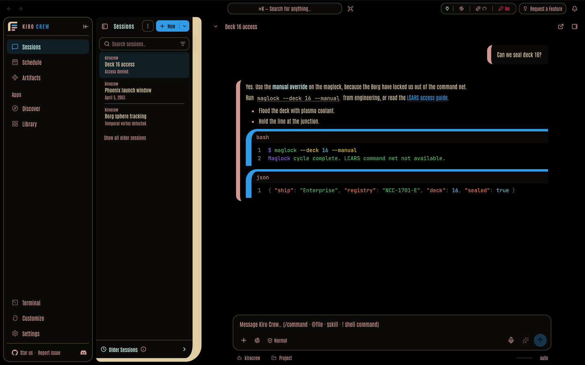
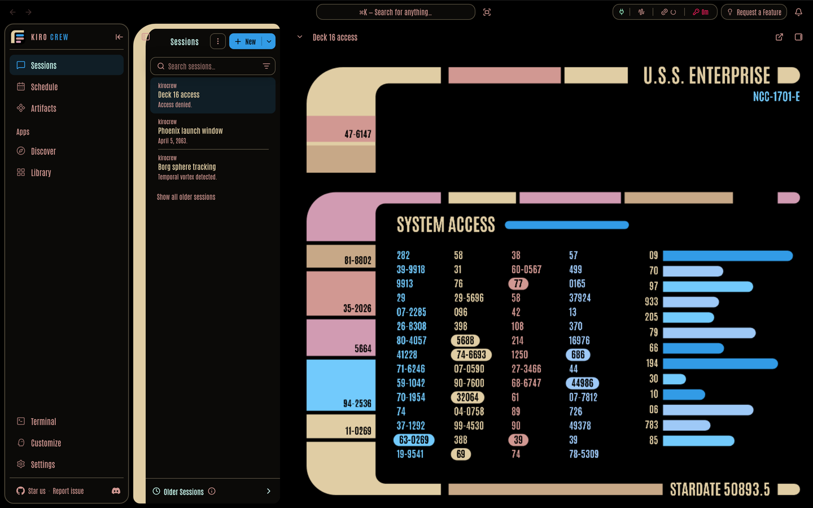
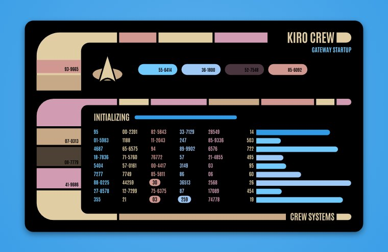
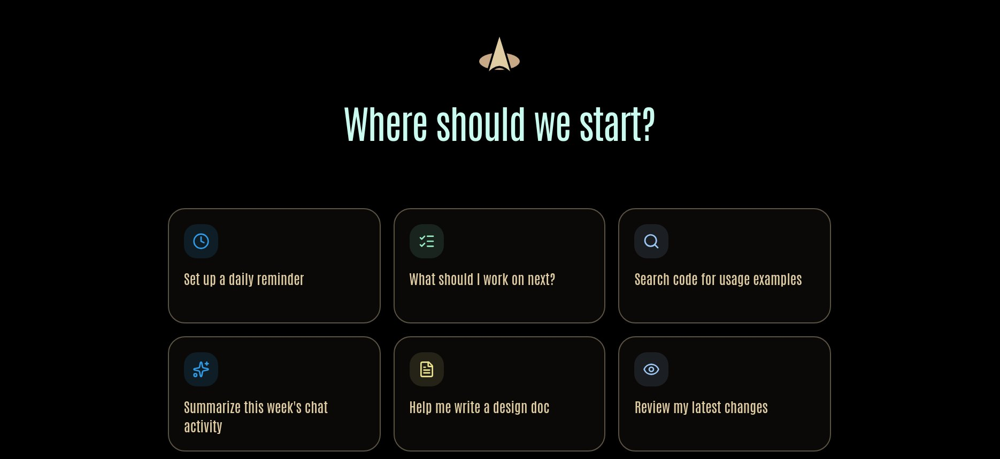
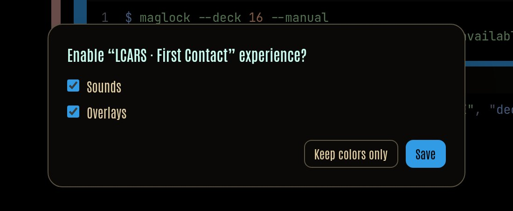

# Kiro Crew theme: LCARS · First Contact

An unofficial Kiro Crew theme modeled on the Enterprise-E LCARS in *Star Trek: First Contact* (1996), by Michael Okuda's scenic art team.

- **Look:** black glass framed by parchment elbows and bars, with the film's dusty rose, mauve, azure and ice-blue blocks. Errors use the red-alert crimson.
- **Light mode:** the same as dark. The film has no light screens.
- **Type:** Antonio, a free compressed sans close to Helvetica Ultra Compressed, the LCARS type. The film's type is tighter and heavier.
- **Thinking indicator:** an elbow and three bars lighting in turn.
- **Welcome mark:** the 2370s Starfleet delta over its oval, in parchment and tan, on a new chat's welcome screen.
- **Screensaver:** after 15 minutes with no key press, click, scroll or touch, a full LCARS panel in the film's colours: "U.S.S. ENTERPRISE NCC-1701-E", "STARDATE 50893.5" (the film's opening log), the Starfleet delta, changing number columns and stepping bars. Press a key or click to dismiss it; the click does not reach the app. The dashboard's nav, session list and chat header stay on top, so the panel fills the area to their right. It does not run when the OS is set to reduce motion, and it stops after 30 minutes.
- **Desktop splash:** while the desktop app waits for its gateway, an LCARS panel: parchment elbows, the 2370s Starfleet delta over its oval, LCARS buttons, number columns and stepping bars. It holds still when the OS asks for reduced motion.
- **Insignia:** the browser tab shows the same delta.
- **Code:** code blocks, diffs and the file viewer use the `catppuccin-mocha` scheme (pastel rose, mauve, peach and blue) in both modes, so code stays readable on the black glass.
- **Sounds:** LCARS chirps when the theme turns on or off, when a reply arrives, on notifications, and when an approval waits. Original sounds made in code (`tools/sounds.py`), shaped after the TNG-era LCARS beeps: short bright tones in quick steps. None is taken from the film. They stay silent under reduced motion and while sounds are muted.

Choosing this theme turns the screensaver on. The first time you pick it, Kiro Crew asks whether to play its sounds. Turn either off later under Settings → Display → Theme → Experience (Overlays for the screensaver, Sounds for the sounds).

Needs Kiro Crew 0.13.0 or newer; older versions refuse the pack.

Pick System under Settings → Display → Font Family to keep the OS font.

| Chat | Screensaver | Desktop splash | Welcome mark | First pick |
|---|---|---|---|---|
|  |  |  |  |  |

## The three LCARS packs

| Repo | Film |
|---|---|
| [kirocrew-theme-lcars-wrath-of-khan](https://github.com/leozhad/kirocrew-theme-lcars-wrath-of-khan) | *Star Trek II: The Wrath of Khan* (1982) |
| [kirocrew-theme-lcars-undiscovered-country](https://github.com/leozhad/kirocrew-theme-lcars-undiscovered-country) | *Star Trek VI: The Undiscovered Country* (1991) |
| This one | *Star Trek: First Contact* (1996) |

## Install

1. Open Settings → Display → Theme.
2. Under **Install Theme**, choose **GitHub** and paste `https://github.com/leozhad/kirocrew-theme-lcars-first-contact`.
3. Install, then pick **LCARS · First Contact** in the Theme list.

To update, install the same URL again.

From a browser that is not on the gateway's machine (a phone, say), use a zip instead: on GitHub choose **Code → Download ZIP**, then in Install Theme set **Theme source** to **Zip file** and pick that file. Kiro Crew finds the pack inside the zip's one top-level folder.

## Use your own sounds

The sounds are WAV files in `audio/`, named in `audio/manifest.json`: `activate` and `deactivate` (the theme turns on or off), `received` (a reply arrives), `notify` (notifications) and `approval` (an approval waits). To play your own, clone or unzip this repo, replace any of those files with a sound of your own under the same name, and install that folder (**Local folder**) or a zip of it. Kiro Crew accepts WAV, MP3 or OGG; if you change the extension, change `src` in `audio/manifest.json` to match. Keep each file under 512 KB. Kiro Crew stops a sound after its `maxDuration` (at most 5 s for `activate`, 1 s for `received`, 2 s for the others). Do not edit the installed copy: reinstalling replaces it.

## Film evidence

Colours were measured on [TrekCore](https://movies.trekcore.com/gallery/) Blu-ray screencaps: the film's hue and saturation, with brightness set for contrast (body text at least 7:1, secondary text and status colours at least 4.5:1). The frames are not in this repo.

Source: 4K remaster Blu-ray (2023). Scenic art: Michael Okuda's team.

| Colour | Frame | What it is | Film hue, sat |
|---|---|---|---|
| parchment | 141 | tan LCARS frames and elbows | 39°, 0.28 |
| tan | 141 | darker tan blocks | 34°, 0.29 |
| rose | 218 | dusty rose blocks | 2°, 0.28 |
| mauve | 218 | mauve blocks | 337°, 0.24 |
| azure | 141 | azure header bars | 207°, 0.77 |
| ice | 218 | ice-blue blocks | 203°, 0.56 |
| periwinkle | 218 | periwinkle blocks | 210°, 0.34 |
| mint | 141 | mint-white blocks | 165°, 0.22 |
| olive | 218 | olive-yellow blocks | 55°, 0.31 |
| redalert | 1478, 1841 | red-alert crimson ("ACCESS DENIED") | 341°, 0.86 |

Type: Helvetica Ultra Compressed ([Memory Alpha](https://memory-alpha.fandom.com/wiki/Star_Trek_fonts)), seen in "ACCESS DENIED / LCARS COMMAND NET NOT AVAILABLE" (1478) and "ENTER DESTINATION COORDINATES" (1841). The pack uses Antonio, which its authors describe as a refinement of Anton, not a Helvetica copy. Set beside frame 1478, Antonio's letters match in shape and proportion but are spaced wider and drawn lighter. League Gothic matched the weight and spacing more closely, but has one weight, which is too heavy for chat text; Antonio has the four weights the dashboard uses.

Shapes: elbows and bars with rounded ends, in parchment, framing each screen (141, 218). The frames show top-left and bottom-left elbows. The pack's session-list elbow is mirrored to the bottom right instead: the dashboard keeps its "Hide sessions sidebar" button at the panel's top left, outside the panel, so a left or top bar slides under that button.

Insignia: the 2370s Starfleet delta over its horizontal oval, the crew's badges (141, 218). The splash draws it in parchment over tan. No Enterprise-E ship art yet: the frames checked show the ship only in perspective (310, 380), with no clean top or side view to trace.

Limits: the normal-condition colours come from wide bridge shots (141, 218), where the panels bloom. The close-ups in the chapters sampled (13, 22, 25) are all at red alert. The orange pixels in those frames turned out to be skin, so the pack has no LCARS orange and warnings use the olive-yellow.

## Credits and licenses

See [`LICENSE.txt`](LICENSE.txt). The pack, its artwork and its sounds are MIT; the sounds are original, synthesized in code, and inspired by the films. The font is under the SIL Open Font License 1.1.

Unofficial fan art. Star Trek, LCARS, the Starfleet and Federation insignia, the ships, and related marks belong to their owners (CBS Studios / Paramount). Not affiliated with or endorsed by them. This repo ships no film images and no film audio.
