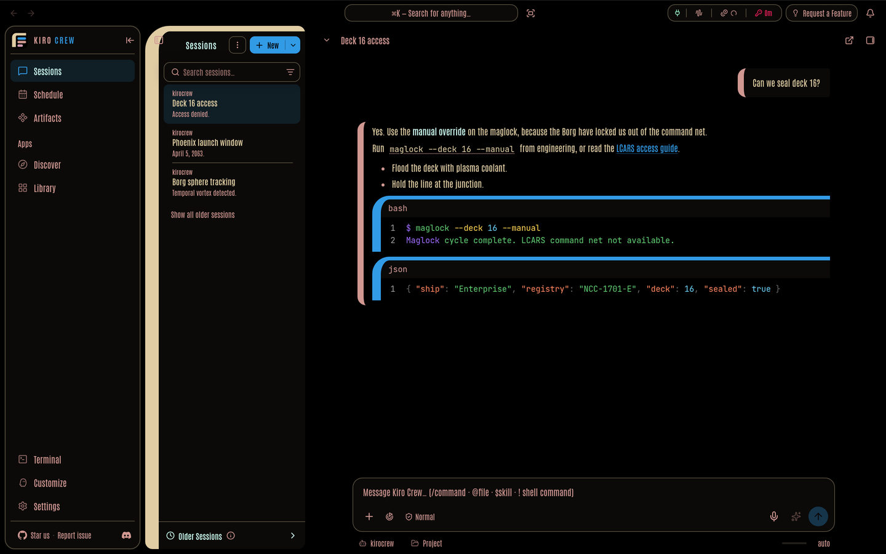
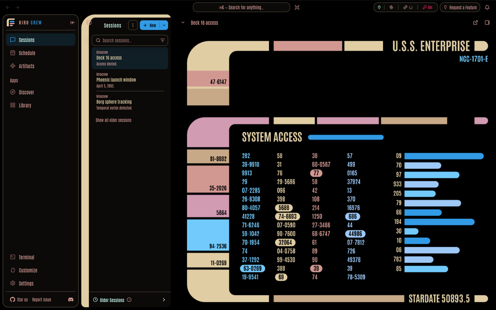

# Kiro Crew theme: LCARS · First Contact

An unofficial Kiro Crew theme modeled on the Enterprise-E LCARS in *Star Trek: First Contact* (1996), by Michael Okuda's scenic art team.

- **Look:** black glass framed by parchment elbows and bars, with the film's dusty rose, mauve, azure and ice-blue blocks. Errors use the red-alert crimson.
- **Light mode:** the same as dark. The film has no light screens.
- **Type:** Antonio, a free compressed sans close to Helvetica Ultra Compressed, the LCARS type. The film's type is tighter and heavier.
- **Thinking indicator:** an elbow and three bars lighting in turn.
- **Screensaver:** after 15 minutes with no key press or click, a full LCARS panel in the film's colours: "U.S.S. ENTERPRISE NCC-1701-E", "STARDATE 50893.5" (the film's opening log), changing number columns and stepping bars. Press a key or click to dismiss it; the click does not reach the app. The dashboard's nav, session list and chat header stay on top, so the panel fills the area to their right. It does not run when the OS is set to reduce motion, and it stops after 30 minutes.

Choosing this theme turns the screensaver on.

Pick System under Settings → Display → Font Family to keep the OS font.

| Chat | Screensaver |
|---|---|
|  |  |

## The three LCARS packs

| Repo | Film |
|---|---|
| [kirocrew-theme-lcars-wrath-of-khan](https://github.com/leozhad/kirocrew-theme-lcars-wrath-of-khan) | *Star Trek II: The Wrath of Khan* (1982) |
| [kirocrew-theme-lcars-undiscovered-country](https://github.com/leozhad/kirocrew-theme-lcars-undiscovered-country) | *Star Trek VI: The Undiscovered Country* (1991) |
| This one | *Star Trek: First Contact* (1996) |

## Install

1. Open Settings → Display → Theme.
2. Under **Install Theme**, choose **GitHub** and paste `https://github.com/leozhad/kirocrew-theme-lcars-first-contact`.
3. Install, then pick **LCARS · First Contact** in the Theme list.

To update, install the same URL again.

## Film evidence

Colours were measured on [TrekCore](https://movies.trekcore.com/gallery/) Blu-ray screencaps: the film's hue and saturation, with brightness set for contrast (body text at least 7:1, secondary text and status colours at least 4.5:1). The frames are not in this repo.

Source: 4K remaster Blu-ray (2023). Scenic art: Michael Okuda's team.

| Colour | Frame | What it is | Film hue, sat |
|---|---|---|---|
| parchment | 141 | tan LCARS frames and elbows | 39°, 0.28 |
| tan | 141 | darker tan blocks | 34°, 0.29 |
| rose | 218 | dusty rose blocks | 2°, 0.28 |
| mauve | 218 | mauve blocks | 337°, 0.24 |
| azure | 141 | azure header bars | 207°, 0.77 |
| ice | 218 | ice-blue blocks | 203°, 0.56 |
| periwinkle | 218 | periwinkle blocks | 210°, 0.34 |
| mint | 141 | mint-white blocks | 165°, 0.22 |
| olive | 218 | olive-yellow blocks | 55°, 0.31 |
| redalert | 1478, 1841 | red-alert crimson ("ACCESS DENIED") | 341°, 0.86 |

Type: Helvetica Ultra Compressed ([Memory Alpha](https://memory-alpha.fandom.com/wiki/Star_Trek_fonts)), seen in "ACCESS DENIED / LCARS COMMAND NET NOT AVAILABLE" (1478) and "ENTER DESTINATION COORDINATES" (1841). The pack uses Antonio, which its authors describe as a refinement of Anton, not a Helvetica copy. Set beside frame 1478, Antonio's letters match in shape and proportion but are spaced wider and drawn lighter. League Gothic matched the weight and spacing more closely, but has one weight, which is too heavy for chat text; Antonio has the four weights the dashboard uses.

Shapes: elbows and bars with rounded ends, in parchment, framing each screen (141, 218).

Limits: the normal-condition colours come from wide bridge shots (141, 218), where the panels bloom. The close-ups in the chapters sampled (13, 22, 25) are all at red alert. The orange pixels in those frames turned out to be skin, so the pack has no LCARS orange and warnings use the olive-yellow.

## Credits and licenses

See [`LICENSE.txt`](LICENSE.txt). The pack is MIT. The font is under the SIL Open Font License 1.1.

Star Trek and LCARS are trademarks of CBS Studios / Paramount. This is unofficial fan work with no affiliation, and it ships no film images.
